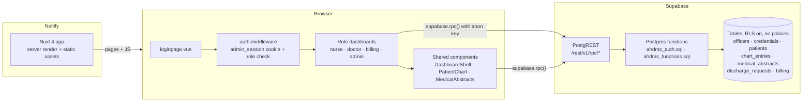

# AHDMS — Automated Hospital Discharge Management System

A web-based discharge management system for **Butuan Medical Center**. It replaces paper charts and nurse carts with one shared dashboard, so Nursing, Physicians, Billing, and Administration can see and clear each patient's discharge without walking paperwork between departments.


> Thesis project. Use **fake patient data only** for testing and demos.

---

##  How the system works

### Roles

Every staff account has exactly one role. The role decides which dashboard opens after sign-in.

| Role | Dashboard | What they do |
|---|---|---|
|  **Nurse** | `/nursedashboardpage` | Register patients and keep the **patient chart**: vital signs, nursing notes, medication, other records. Submit the record for discharge |
|  **Doctor** | `/doctordashboardpage` | Read the patient chart, add advice/orders, approve or reject discharge requests |
|  **Billing** | `/billingdashboardpage` | For doctor-approved discharges, compute the expenses (itemized charges − PhilHealth) and clear the bill, which completes the discharge |
|  **Admin** | `/admindashboardpage` | Register staff accounts, set staff on/off duty, view hospital-wide discharge queue, patients, and weekly stats |

###  Discharge workflow

```
 Nurse keeps the chart       Doctor reads the chart,       Billing computes the
 and submits it for   ─────► adds advice, approves   ────► expenses and clears  ───► Patient discharged
 discharge (pending)         (approved) or rejects         the bill (completed)      (discharge_date set)
```

1. **Chart:** the nurse records vital signs, nursing notes, medication and other records on the patient's chart (**My Patients → Chart**).
2. **Request:** the nurse submits the patient's record for discharge. The status is `pending`. A patient can have only one open request.
3. **Doctor review:** the doctor opens the chart, adds advice/orders, and approves or rejects the pending request.
4. **Billing:** for an `approved` request, billing enters the itemized charges and PhilHealth deduction. The database sums the total, saves the bill, marks the request `completed`, and sets the patient's `discharge_date`.

Request statuses: `pending` → `approved` → `completed`, or `pending` → `rejected`.

### Where the logic lives

All business rules run **inside Postgres** as functions (RPCs) in `supabase/`. The frontend only calls them with `supabase.rpc(...)`. Tables have Row Level Security enabled with no policies, so the browser cannot read or write tables directly.

| File | Contents |
|---|---|
| `supabase/ahdms_schema.sql` | Tables: `officers`, `credentials`, `patients`, `chart_entries`, `medical_abstracts`, `discharge_requests`, `billing` |
| `supabase/ahdms_auth.sql` | `login_officer`, `register_officer` (bcrypt password hashing via pgcrypto) |
| `supabase/ahdms_functions.sql` | Workflow: patient chart, discharge requests, approve/reject, billing, listings |
| `supabase/ahdms_cleanup.sql` | Upgrades an existing database: adds new columns and removes legacy functions (incl. the removed task workflow) |

---

##  Architecture

Three layers. The browser never touches a table: every read and write is a call to a Postgres function.



### Request path

1. **Sign in:** `loginpage.vue` calls `login_officer`. Postgres checks the bcrypt hash in `credentials` and returns the officer and role.
2. **Session:** the app stores `{ id, email, fullName, role }` in the `admin_session` cookie for 8 hours.
3. **Routing:** `middleware/auth.ts` sends visitors with no session to `/loginpage`, and sends anyone opening another role's dashboard back to their own.
4. **Data:** each dashboard calls only the functions it needs. Functions run with table access; the anon key alone cannot read a table.

### Which page calls what

| Caller | Postgres functions |
|---|---|
| `loginpage.vue` | `login_officer` |
| Nurse dashboard | `register_patient`, `update_patient_info`, `list_patients_by_officer`, `create_discharge_request`, `list_discharge_requests_by_requester`, `list_officers` |
| Doctor dashboard | `list_discharge_requests_detailed`, `approve_discharge_request`, `reject_discharge_request`, `list_all_patients` |
| Billing dashboard | `list_discharge_requests_detailed`, `clear_billing`, `list_billing_records`, `list_all_patients` |
| Admin dashboard | `register_officer`, `list_officers`, `set_duty_status`, `list_all_patients`, `list_discharge_requests_detailed` |
| `PatientChart.vue` | `add_chart_entry`, `update_chart_entry`, `list_chart_entries` |
| `MedicalAbstracts.vue` | `create_medical_abstract`, `update_medical_abstract`, `list_medical_abstracts` |

Role checks happen in the browser (middleware), not in the functions. See [Known limitations](#known-limitations-planned-work).

---

##  Getting started

### 1. Install

```bash
npm install
```

### 2. Set up the database (Supabase SQL Editor)

Open **Supabase Dashboard → SQL Editor**, paste each file, and click **Run**, in the order below.

**New database:**

1. `supabase/ahdms_schema.sql`: ⚠️ **drops and recreates all tables, so existing data is deleted**
2. `supabase/ahdms_auth.sql`
3. `supabase/ahdms_functions.sql`

**Already have data?** Do not run the schema file. This order keeps your rows:

1. `supabase/ahdms_cleanup.sql`
2. `supabase/ahdms_auth.sql`
3. `supabase/ahdms_functions.sql`

Then create the first admin. This works only while the `officers` table is empty:

```sql
select * from register_officer('admin@test.com', 'ChangeMe123!', 'Test Admin', 'admin');
```

Every other account (nurse, doctor, billing) is created from the **Admin → Staff** page.

### 3. Environment variables

Copy `.env.example` to `.env` and fill in the values from **Supabase → Project Settings → API**:

```
SUPABASE_URL=https://<your-project>.supabase.co
SUPABASE_KEY=<anon / publishable key>
```

Use the **anon** key only. Never put the `service_role` key in this project. `.env` is gitignored.

### 4. Run

```bash
npm run dev        # http://localhost:3000
npm run build      # production build
npm run preview    # serve the production build
```

### 5. Try the full workflow

1. Sign in as the admin → **Staff** → register one nurse, one doctor, and one billing officer.
2. Sign in as the nurse → **My Patients → Add Patient** (fake data) → **Chart** → add vital signs, a nursing note, a medication.
3. Nurse → **Discharge Requests → Request Discharge**.
4. Doctor → **Discharge Requests** → click the patient's name to read the chart and add advice → **Approve**.
5. Billing → **Awaiting Billing → Compute Bill** → enter the charges → **Clear Bill & Discharge**.
6. Admin → **Dashboard**: the discharge shows as completed.

---

##  Project structure

```
app/
  assets/css/tailwind.css     Design tokens (colors, font, radius), transitions
  components/
    AppLogo.vue               Brand mark (cross with exit arrow = discharge)
    DashboardShell.vue        Shared sidebar, top bar, search, theme toggle, logout
    PatientChart.vue          Patient chart modal (vitals, notes, medication, other, doctor's advice)
  composables/
    useAdminSession.ts        Session cookie + role → dashboard routing
    useDarkMode.ts            Light/dark theme
    useOfficerName.ts         Initials for avatars
  middleware/auth.ts          Redirects to /loginpage; blocks other roles' dashboards
  pages/
    index.vue                 Landing page
    loginpage.vue             Staff sign-in
    nursedashboardpage.vue    Nursing
    doctordashboardpage.vue   Physicians
    billingdashboardpage.vue  Billing
    admindashboardpage.vue    Administration
  types/database.types.ts     Row types for RPC results
supabase/                     SQL to run in the Supabase SQL Editor
```

**Stack:** Nuxt 4 (Vue 3, Vite), Tailwind CSS v4, Lucide icons, Supabase (Postgres + RPC).

---

##  Design system

| Token | Light | Use |
|---|---|---|
| Ward ink | `#0F2622` | Sidebar, login brand panel, brand badges |
| Theatre green | `#1F6B57` | Primary buttons, active states |
| Clinical paper | `#F3F6F5` | App background |
| Amber `warning` | `#A15C00` | Pending / needs action |
| Blue `info` | `#2463A6` | Informational |
| Green `success` | `#237A4B` | Cleared / approved |
| Red `danger` | `#B42318` | Rejected / destructive |

- **Typeface:** Atkinson Hyperlegible Next, built so 1/l/I and 0/O never look alike, which matters for room numbers and amounts.
- **Icons:** Lucide at 1.75 stroke, with one meaning per icon: bed = patients, open door = discharge, signature = physician approval, receipt = billing, ID card = staff.
- **Dark mode:** every token has a dark value. Use the moon/sun button in the top bar.
- Use the tokens (`bg-primary`, `text-warning`, `bg-success/10`, etc.), not raw hex values.

---

##  Known limitations (planned work)

- **Security:** sign-in uses a custom `credentials` table and a browser cookie, not Supabase Auth. The RPCs trust the officer ID sent by the browser, so anyone holding the public anon key can call them. **Do not store real patient data** until this moves to Supabase Auth + Row Level Security policies.
- **Not yet built:** document upload and OCR with a human review step, live updates (Supabase Realtime), the audit log, a Medical Records role, and evaluation metrics export.
- **Out of scope:** PhilHealth claims processing. The existing `philhealth_*` fields are scheduled for removal.
